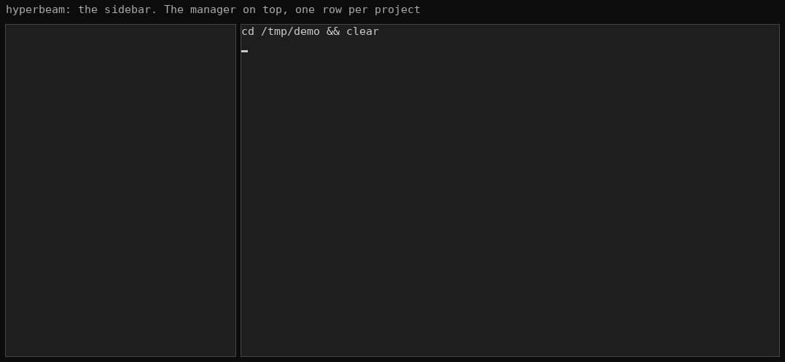
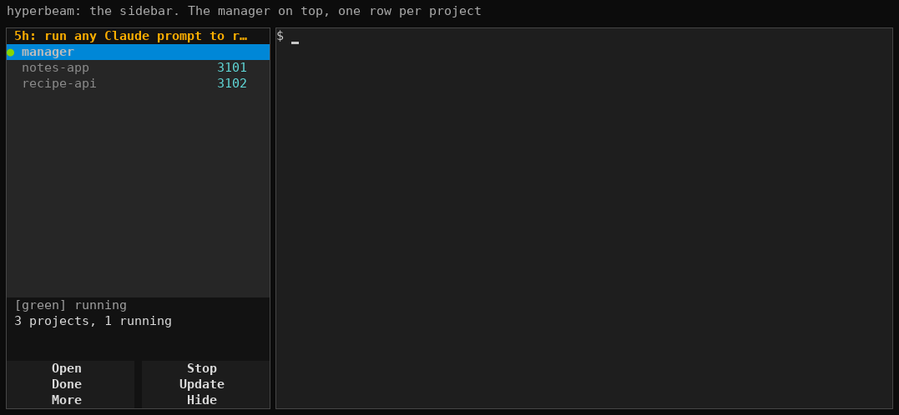
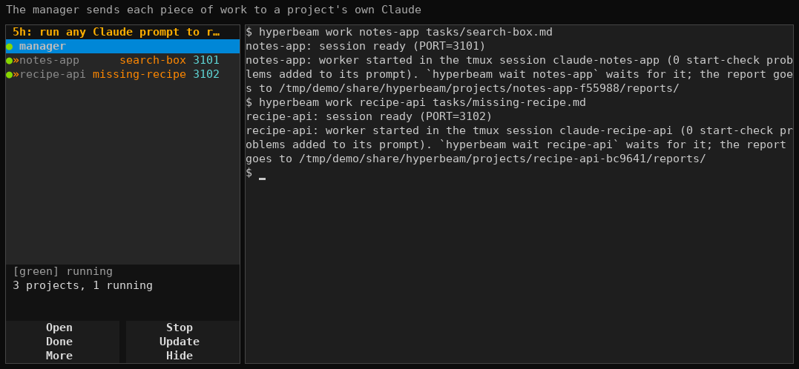
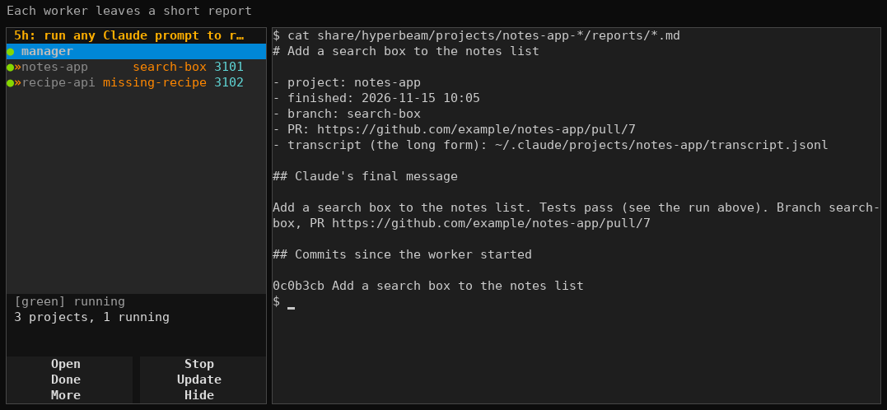

# hyperbeam

A personal "senior engineer" for many AI-assisted prototype projects on one Linux laptop (Ubuntu, GNOME/Wayland, kitty, tmux, Claude Code).



*A recording of the loop with two throwaway projects and a fake Claude (`tools/demo/`, made in the lab).*

## The problem
Prototypes built with AI pile up: a dozen projects, each with its own long Claude conversation. Long conversations drown in their own context, re-read it on every
turn and eat the usage limit (12 hyperbeam sessions re-read about 874M cached tokens). Docs stop matching the code, decisions live in old chats, and a test run
can break something live.

## How hyperbeam solves it
- **A manager to plan with.** The first row of the sidebar is a Claude on Opus. You talk with it about what to work on, across all projects. It is read-only on the projects.
- **A fresh worker per task.** After you say yes, the manager sends the piece of work to the project's own Claude as a worker (`hyperbeam work`), waits (`hyperbeam wait`),
  reads the short report and closes the worker (`hyperbeam close`, which also removes its merged worktree; `hyperbeam tidy` lists and deletes merged branches, `--yes` to delete). The context never grows: each task starts clean. hyperbeam never starts Claude work by itself.
- **A short report** per task: the task, Claude's final message, branch, commits, PR, and a link to the full transcript for when you need the long form. `hyperbeam reports` lists them with what each cost (tokens, calls, active minutes, lab seconds); `hyperbeam copy-last` copies Claude's last message.
- **A session per project:** one tmux session with Claude Code, a shell, the services (started in order, on a fixed port) and logs. The sidebar shows status dots (running,
  Claude working or waiting, PR open) and `»` on a project with a worker. The phone attaches to the same sessions over SSH (Tailscale).
- **The lab.** All agent testing runs as a separate user (`hyperbeam lab run ...`), so tests and test servers can't touch your live sessions.
- **The same verbs everywhere:** `install`, `update`, `test`, `version`, `help`, `restart`, for every project, plus **Merge** (merges a project's open PRs oldest first, then updates it).
- **One set of rules** (RULES.md) every project follows, and memory in the repo (CLAUDE.md, `docs/decisions/`).

## The project loop
For a project you want in shape, the manager runs one worker task at a time, reading each report and PR (and sending feedback with `send`) before the next:
align + audit (one PR plus the audit in the report) → fixes for the biggest problems, one PR each → re-audit (read-only) → refactor and cleanup → README with pictures.
**The usage rule:** before each task the manager reads the 5-hour limit (`hyperbeam usage`): under 50% it builds and fixes; from 50% only refactor, docs and README.




## Install
```
git clone https://github.com/skillkraftz/hyperbeam ~/projects/hyperbeam
cd ~/projects/hyperbeam && bash install.sh
sudo bash lab/setup.sh     # once, for the lab
```
`install.sh` puts the app in `~/.local/lib/hyperbeam` (kept current by `hyperbeam update` and Merge) and links `hyperbeam`, `kk` and a tmux conf to it. You work on
hyperbeam itself in `~/projects/hyperbeam`, on branches, like any project.

## The commands that matter
| | |
|---|---|
| `hyperbeam` (Ctrl+Alt+H) | the sidebar: click a row, double-click to open its session |
| `hyperbeam work NAME FILE` / `wait NAME` / `send NAME FILE` / `close NAME` | the manager's loop: start a worker, wait for its report, send it review feedback, end it |
| `hyperbeam status` / `reports [NAME]` | which sessions and workers exist and what they are doing / the reports with their cost |
| `hyperbeam tidy [NAME] [--yes]` | list (and with `--yes` delete) merged branches and worktrees |
| `hyperbeam copy-last [NAME]` | copy Claude's last message to the clipboard |
| `hyperbeam NAME update` (also `install`, `test`, `version`, `help`, `restart`) | the same verbs for every project |
| `kk` (`hyperbeam info`) | a project's URLs: services, ports, Tailscale, open PRs |
| `hyperbeam lab run --why TEXT -- COMMAND` | run anything test-like in the lab |
| `hyperbeam new NAME --cli` or `--web` | a new project that already has the verbs |
| `hyperbeam usage`, `hyperbeam list`, `hyperbeam phone` | limits, the project list, the phone link |



## More
Roadmap: [IDEAS.md](IDEAS.md) · the map: [docs/SYSTEM.md](docs/SYSTEM.md) · details: [docs/REFERENCE.md](docs/REFERENCE.md) · the why: [docs/decisions/](docs/decisions/) ·
the rules: [RULES.md](RULES.md) · how this repo works: [CLAUDE.md](CLAUDE.md) · the sidebar's design: [docs/UI.md](docs/UI.md).

Regenerate the pictures (in the lab): `bash tools/demo/regen`.
